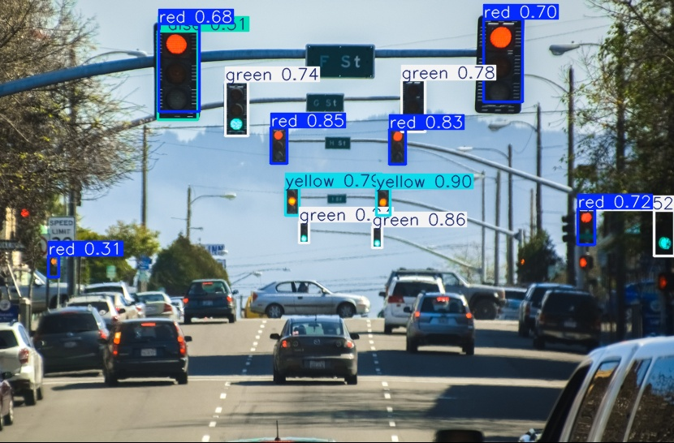
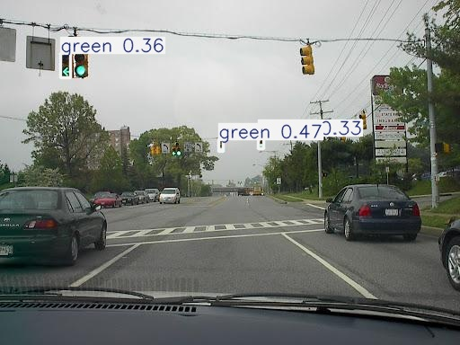

# UGV Autonomous Vehicular Traffic Light Detection (YOLOv8)
**High-Reliability Deep Learning Model** for interpreting **Vehicular Traffic Light signals** to govern UGV autonomous speed and stopping behavior.
---

### Project Objectives

* **Goal:** To achieve **near-perfect accuracy** in detecting and classifying the current state of vehicular traffic lights under various environmental conditions.
* **Function:** Implement a system capable of differentiating the **four critical states** (Red, Yellow, Green, Off) to ensure safe and rule-compliant UGV operation.

### Methodology Highlights

* **Architecture:** Utilizes the **YOLOv8** object detection framework.
* **Data Source:** Trained on the **Bosch Small Traffic Lights Dataset**, a specialized dataset designed for advanced automotive vision tasks, ensuring high relevance and quality. 
* **State Classification:** The model is trained to classify the following four critical traffic light states:
    * **Red** (Stop)
    * **Yellow** (Caution/Prepare to Stop)
    * **Green** (Proceed)
    * **Off** (Requires interpretation as a sign or non-functional)

    ### Dataset Source

* **Bosch Small Traffic Lights Dataset:** [https://hci.iwr.uni-heidelberg.de/content/bosch-small-traffic-lights-dataset](https://hci.iwr.uni-heidelberg.de/content/bosch-small-traffic-lights-dataset)
    * *Note: This repository contains the code and configuration used for the training, validation, and fine-tuning splits on the downloaded data.*

    ### Inference Results

Below are samples of the model running on unseen validation data:

**1. Red Light Detection**

**2. Green Light Detection**

